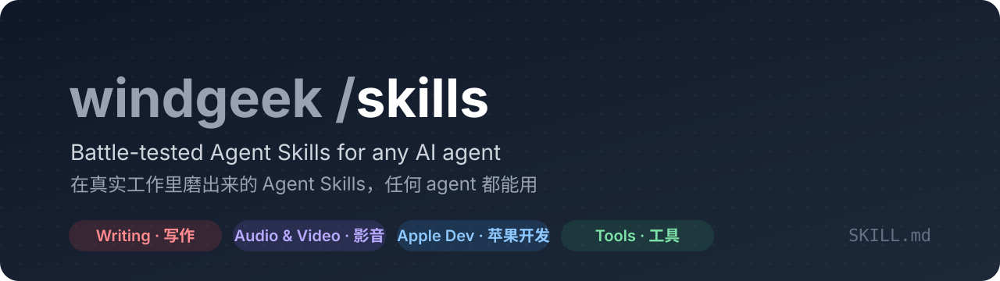

  <a href="README.md">English</a> · <b>简体中文</b>

  
  
  

Agent Skill 是一个文件夹，里面是说明、参考资料和脚本，AI agent 碰到对应的任务时自动加载。这里的每个 skill 都来自真实、反复做的工作，里面每条规则都是踩过坑才加上的。它们用开放的 `SKILL.md` 格式，Claude Code、Codex 和其他能读 skill 的 agent 都能用，不绑定任何一家。

## 快速开始

对你的 agent 说：

> 帮我安装 https://github.com/windgeek/skills 里的 **plain-reply** 这个 skill。

装好后直接说你要做什么，比如“帮我回一下这条消息”“用我的声音给这段文案配音”。agent 会自己选对的 skill；需要下载什么，会先说明、征得你同意。

手动安装

把 `skills/` 里的文件夹拷到你的 agent 的 skill 目录，比如 Claude Code 是 `~/.claude/skills/`，读共享目录的 agent 是 `~/.agents/skills/`。Claude Code 用户也可以把本仓库当作插件市场添加（`.claude-plugin/marketplace.json`）。

## Skill 一览

<!-- SKILLS:BEGIN (auto-generated by scripts/sync.py) -->
### 写作与内容

| Skill | 做什么 |
|---|---|
| [`chinese-human-editor`](#chinese-human-editor) | 中文成稿的去 AI 腔终审：清除假转折、假金句、整齐排比、抽象词和万能升华，再用脚本核对数字、引语、专名、链接没有漂移。 |
| [`douyin-interest-card`](#douyin-interest-card) | 做抖音兴趣卡（在创作者中心 AI工坊 生成的可交互 AI 内容卡）：设计玩法、写卡片和落地页文案、按平台规范自查、在 AI工坊 生成和修改、提交审核。 |
| [`novel`](#novel) | 百万字级长篇网文逐章续写不丢线：分层加载上下文、连贯性日志、角色状态、伏笔追踪、节拍表和写后校验清单；按番茄小说平台的规则调校。 |
| [`plain-reply`](#plain-reply) | 把查完、算完、排完障的结果写成能直接粘贴发出去的“人话”消息：先给结论，按对象分段，数字带单位，对内对外口径分开；你改过的稿子它会学进去。 |
| [`wechat-article`](#wechat-article) | 策划、研究、撰写微信公众号文章，去掉 AI 腔：选题卡、证据、标题与首屏、删稿、发布前质量门；可选推送到草稿箱。 |
| [`wechat-typeset`](#wechat-typeset) | 把 Markdown 母稿排成公众号正文，“书页”风格：宋体、居中标题、留白、全篇一种点缀色，原文一个字不改；附渲染、合规校验和一键复制的预览页。 |

### 音频与视频

| Skill | 做什么 |
|---|---|
| [`code-cinema`](#code-cinema) | 用代码导演并渲染有艺术性的 MV 与短片：先分析歌，再原创贴合它的画面风格，风格库随每支片子增长。 |
| [`suno-music-producer`](#suno-music-producer) | 为 Suno 创作和修改原创歌曲，直接输出可粘贴的 Title、Styles、参数和 Lyrics。 |
| [`voice-clone`](#voice-clone) | 在 Mac 本地复刻你自己的声音，生成中文（及中英混合）配音。 |

### 苹果开发

| Skill | 做什么 |
|---|---|
| [`apple-app-localization`](#apple-app-localization) | 用 Xcode String Catalog 给苹果平台 app 做国际化与翻译：迁移旧 .strings、复数、生成符号，按系统自身译名翻译并复核，多语言验收。 |
| [`ship-macos-apps`](#ship-macos-apps) | 和 AI 编程 agent 一起安全地开发、发布 macOS 原生 app：Debug/Release 身份分离、签名、隐私权限、菜单栏图标、TestFlight 与上架检查。 |

### 工具与效率

| Skill | 做什么 |
|---|---|
| [`knowledge-placement`](#knowledge-placement) | 决定一条经验、规则、决定该写在哪里，让你用的所有 agent（Claude Code、Codex、Gemini CLI、Antigravity……）都读得到：全局约定、共享 skill、项目 AGENTS.md、项目文档，还是某个 agent 的私有记忆；也负责盘点和迁移散落的记忆。附 Claude Code 记忆的只读盘点脚本。 |
| [`project-cleanup`](#project-cleanup) | 清理项目和它背后的工具缓存（Xcode、Node、Python、Rust、Gradle、Docker）：先盘点，没用的删、会复用的留，查清引用再动手，最后报告释放多少；附只读盘点脚本。 |
| [`skill-refine`](#skill-refine) | 每次改完 skill 自动做一遍精炼：新规则归到对的主题、合并重复、消除前后冲突、控制篇幅；附只读体检脚本和可选的提醒钩子。 |
| [`zlib-books`](#zlib-books) | 用 zlib 命令行搜书、下载电子书并推送到 Kindle：按质量规则挑选最佳版本，附自带的发信脚本；需要你自己的账号。 |
<!-- SKILLS:END -->

## chinese-human-editor

写完的中文稿，常常一眼就看得出是模型写的：“不是……而是……”、对称的金句、三连排比、“底层逻辑”、结尾突然谈时代。这个 skill 在成稿之后、发布之前，让 agent 换成编辑的身份单独过一遍：先用脚本扫出线索（叙述和对话分开计数），逐条判断后修改，最后用另一个脚本比对改稿前后的数字、引语、书名、链接和英文专名，确认去 AI 腔的时候没有顺手改掉事实。公众号、评论、文学小说、网文按体裁调整力度。

`wechat-article` 和 `novel` 都会调用它。

需要：Python 3。

## douyin-interest-card

抖音“兴趣卡”是按兴趣推荐分发的轻量互动卡片，在抖音创作者中心的 AI工坊 里用文字描述生成。这个 skill 让 agent 把你的一个话题做成一张卡：先定玩法（卡内一个完整的小互动，比如拖滑块后给出结果；落地页接着往深里讲），写好文案和给 AI工坊 的描述，按平台创作规范逐条自查；然后在 AI工坊 里生成、在预览里把每个分支点一遍、一轮轮提修改，最后填发布配置。点“确认发布”之前会先问你。AI工坊 的操作经验和它常犯的错都写在 references 里。

- `render_states.py`：把一张标好部件的 SVG 渲染成一组透明 PNG，每张对应一个交互状态（AI工坊 的卡片环境显示不了 SVG）。

需要：抖音创作者中心账号、能操作你已登录浏览器的 agent 工具；配图脚本需要 Python 3 和 Google Chrome。

## novel

长篇网文写到几十章以后，最常见的事故是忘事：人物知道了不该知道的事、约好的见面没下文、地名前后不一、伏笔埋了没收。这个 skill 让 agent 把小说当成一个项目来写：设定、大纲、人物、连贯性日志、伏笔表都存在 `novel/` 目录里，每写一章前按需加载，写完后逐项校验并更新。之后你只要说“继续”，它会自己恢复进度、判断要不要先做一致性检查或补大纲，然后写下一章。

- 章节字数、标题、正文排版按番茄小说的平台限制设定；用在别的平台时改一下即可。
- 已在实际写作中跑过百万字级别的连载。每 10 章自动做一次一致性检查，日志和伏笔表按卷归档，写到几百章、上百万字，每章要加载的文件仍然很小。

需要：能读写本地文件的 agent。

## plain-reply

查完问题、对完账、排完障，最后一步往往是“给人回一句话”。模型默认写出来的是报告：加粗标题、编号、“综上所述”，贴进微信全是星号，对方也看不下去。这个 skill 让 agent 写能直接粘贴发出去的消息：第一句就是结论，按人或按对象分段，人名、时间、金额、证据带全，口语、不绝对；对内对外分开口径，要外发的附件先脱敏；你改过它的稿子，它会把你的改法总结成规则，下次照着写。

- 适用于微信、飞书、钉钉、Slack、群聊和短邮件；回复语言跟着你。
- 附带改写前后的示例（报告腔 → 人话、长稿 → 精炼稿、更正）。

需要：任意 agent；能长期保存偏好的 agent（有记忆或项目说明文件）效果更好。

## wechat-article

写读者愿意读完的公众号文章：动笔前先写选题卡（读者、张力、主张、回报、证据），给每个承重结论找到原始来源，再按结构、段落、句子三层删稿，最后过十项发布前质量门；科普稿另有一套“谜题—机制—迁移”的写法。输出两份 Markdown 母稿。

- 排版交给同仓库的 `wechat-typeset`。
- 推送到草稿箱是可选的，需要你自己在 `.env` 里填公众号的 AppID 和 AppSecret，而且每次都要你明确说“发布”才会执行。

需要：Python 3。

## wechat-typeset

把 Markdown 母稿排成能直接粘贴进公众号编辑器的正文。样式只有一套，叫“书页”：宋体正文、居中的章节标题、大段留白，全篇只有一种点缀色（默认朱砂，可按文章内容换），只用在章节编号、列表符号、注释角标和文末一个小方块上；没有卡片、图标、渐变和“点赞在看”。排版由脚本确定性完成，原文一个字不改。

- 链接改成角标 [n]，网址列在正文之后（公众号正文外链点不开）。
- 附合规校验（会被公众号过滤的写法、半角标点）和预览页：手机宽度、可切深色模式、一键复制正文。

需要：Python 3。

## code-cinema

用代码（Canvas / WebGL + 无头浏览器 + ffmpeg）给歌或故事做有艺术性的 MV 和短片，不用视频生成模型。

**它会进化。** 每次做片子，它先分析歌的内容，再按“媒介即内容”为这首歌**原创一个画面风格**，写成风格规格存进风格库；已有风格只在真的贴合时才复用，连续两支片子不会用同一个风格。所以你用得越多，风格库越丰富，自带的 4 个风格只是起点。

**交付前自动审片。** 自带框景检查（`framecheck.mjs`）：硬切处画面是否落在拍点上、不在拍点上的闪烁、叠字、字出画、长时间静止、并行渲染是否逐帧一致，问题帧会标出红框拼成一张图。

需要：macOS（Apple 芯片）、Chrome、ffmpeg、Node.js、Python 3。

## suno-music-producer

用 Suno 写歌：从一句话、一个律动或一个场景发展出完整的歌，直接给出可粘贴的 Title、Styles、参数和 Lyrics；中文歌词会逐句检查唱读时的重音、倒字和换气。

需要：Suno 账号。

## voice-clone

在 Mac 本地复刻**你自己的声音**，生成中文（及中英混合）配音；全部在本机运行，音频不上传。

- 仓库不含任何模型；首次使用时会在你同意后下载约 10 GB（代码、模型、依赖）。
- 配完自动“听写自查”：用 macOS 26 自带的离线语音识别把每句配音转成文字，和台词按拼音比对，标出可能读错、漏字的句子，缩小你需要重点试听的范围。
- 只复刻本人或已获明确授权的声音；发布时按平台和当地法规标注“AI 生成内容”。

## apple-app-localization

给 macOS / iOS 等苹果平台 app 做国际化和翻译：把旧的 `.strings` 迁移到 String Catalog，补上复数，用生成的符号让拼错的 key 变成编译错误；翻译时系统名词（访达、废纸篓、快速查看……）一律从 macOS 自己的资源里查，不靠猜；起草和复核分两遍做，最后做多语言运行时验收。以后每次功能改动新增文案，它也会自动把各语言补齐。

需要：macOS、Xcode 26 以上、Python 3。

## ship-macos-apps

让 AI 编程 agent 参与 macOS app 开发时，最容易出事的是“身份”：Debug 和正式版共用 bundle ID、agent 从命令行启动了正式版，结果隐私权限、菜单栏图标在开发机上错乱，别人的机器却正常。这个 skill 把开发、本地 Release、TestFlight、上架分成四条互不污染的线，并附只读的项目和已安装 app 体检脚本、发布前检查清单，以及改版本号和 build 号（可直接在原来的基础上加一）、核对归档版本号的小脚本（避免 Organizer 里显示旧 build 号），以及不用打开 Xcode 的归档和上传脚本（上传前先列出版本、团队、权限，确认后才传；支持 iOS 和 Mac Catalyst）。另有商店截图海报、App Store Connect 多语言填写与截图上传、iPhone Duo（折叠屏）适配的经验。

需要：macOS、Xcode。

## knowledge-placement

同时用几个 agent 时，每个 agent 都有自己的“记忆”。Claude Code 的自动记忆存在 `~/.claude/projects/<项目>/memory/`，只有 Claude 读得到：写在那里的规则，对 Codex 等于不存在。记忆还按项目路径存放，项目搬家、改名后就悄悄失联。这个 skill 让 agent 把每条知识只写一处，而且写在所有 agent 都读得到的地方：一份全局约定（其他 agent 的全局文件软链接过去）、一个共享的 skill 目录、项目的 `AGENTS.md`（`CLAUDE.md`、`GEMINI.md` 软链接到它）、放长内容的项目文档；私有记忆只放那个 agent 专属的东西，通常是空的。也包括定期梳理：备份、盘点、逐条搬走或删除、报告。

- `inventory.py`（只读）：列出每个 Claude Code 记忆目录、对应的项目（已不存在的会标出）、项目里有哪些说明文件、每条记忆的类型和大小。

需要：Python 3（运行脚本时）。

## project-cleanup

项目目录往往不大，真正占空间的是它背后的工具缓存：Xcode 的 DerivedData、Archive、模拟器，node_modules，Python 虚拟环境，Gradle、Cargo、Docker。这个 skill 让 agent 先把项目和这些缓存一起盘点，按“没用的删、会复用的留”分类：能自动重建的缓存和被新版取代的旧产物删掉；模拟器、已发布版本的符号文件、当前流水线的原始素材留着。删之前查清引用（连同废弃脚本一起清掉），向你确认清单，删完报告释放了多少。

- `scan.py`（只读）：项目里最大的目录、不在 git 里的大文件（删了无法从 git 恢复）、可疑的零碎文件、按项目类型探测到的全局缓存和磁盘剩余空间。

需要：Python 3，macOS 或 Linux。

## skill-refine

skill 越用越长：每次踩坑、每次被纠正，都往里加一条。只往后追加，几轮之后同一条规则写了三遍，新规则和旧规则互相打架，真正要紧的硬规则埋在一堆案例里。这个 skill 让 agent 在**每次改完 skill 后**做一遍精炼：通读全部内容，把新规则归到对的主题下，合并重复，按你最新的意思统一冲突，把案例挪进 references/、让 SKILL.md 保持精简，并且不弱化你说过的任何一条要求，最后报告改了什么。

- `lint_skill.py`（只读）：查结构（frontmatter、篇幅、断链、没人引用的文件）、重复条目（跨文件、跨 skill）、冲突线索（同一话题不同数值、“必须 / 不要”相反）、按时间堆积的迹象。
- `remind_hook.py`（可选）：Claude Code 的 PostToolUse 钩子，写入 skill 目录后提醒 agent 精炼，每个 skill 每个会话只提醒一次；安装前需要你同意。

需要：Python 3。

## zlib-books

这个 skill 让 agent 用 [zlib](https://github.com/heartleo/zlib) 命令行帮你找书：先搜索，按“单本优先、评分和质量分高、正规出版社、体积合理、epub 优先”挑出最多 5 个候选，你选定后再下载，并用自带脚本把文件邮件推送到 Kindle。下载额度有限，所以不会试探性下载。请只用于你有权获取的书；登录和邮箱授权码都由你自己在终端里完成。

- `send_kindle.py`：读取 `zlib kindle config` 保存的设置和 `ZLIB_SMTP_PWD`，把文件作为附件发到 Kindle 地址，附件名自动转成 ASCII。

需要：Python 3、[zlib](https://github.com/heartleo/zlib) 命令行及你自己的账号、邮箱 SMTP 授权码和亚马逊“已认可的发件人”设置。

## 许可证

MIT，见 [LICENSE](LICENSE)。第三方组件保留各自的许可证。

贡献说明：[CONTRIBUTING.md](CONTRIBUTING.md)
